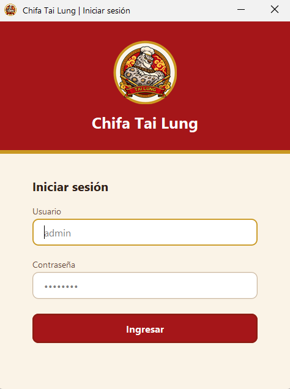
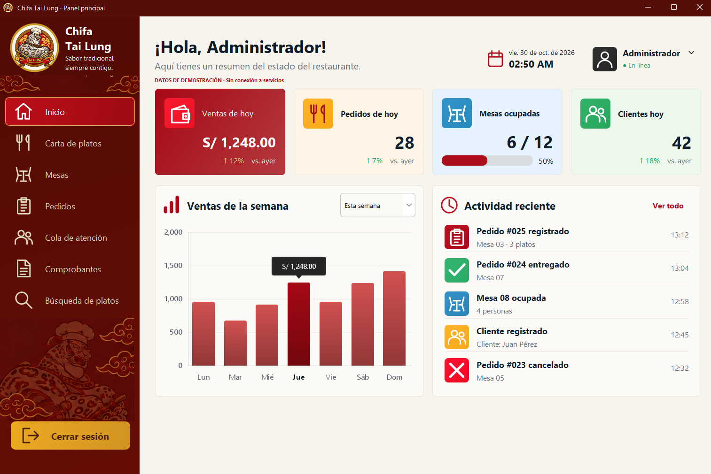

# Chifa Tai Lung

**Sistema de gestión para un restaurante chifa**, desarrollado como proyecto académico en **Java Swing**, utilizando **Apache NetBeans** y **Maven**.

El proyecto busca facilitar la organización de las operaciones del restaurante mediante una aplicación de escritorio con interfaces gráficas para el personal.

> **Estado del proyecto:** en desarrollo. Actualmente se han creado los formularios gráficos de inicio de sesión y menú principal. Las demás funcionalidades descritas a continuación forman parte del alcance previsto y no deben interpretarse como implementadas.

## Capturas de pantalla

A continuación, se muestran las interfaces gráficas desarrolladas para el sistema de gestión **Chifa Tai Lung**, utilizando Java Swing.

### Inicio de sesión

Interfaz de autenticación diseñada para permitir el acceso de administradores y empleados al sistema.



### Menú principal

Panel principal del sistema, diseñado para facilitar la navegación entre los diferentes módulos de gestión del restaurante.



## Funcionalidades

### Interfaces desarrolladas

- **Inicio de sesión:** formulario `FrmLogin`.
- **Menú principal:** formulario `FrmPrincipal`, con componentes visuales personalizados.
- **Recursos gráficos:** iconos SVG, logotipos e imágenes integrados al proyecto.

### Funcionalidades planificadas

- **Gestión de platos:** administración y consulta de la carta.
- **Gestión de mesas:** control manual del estado de las mesas.
- **Gestión de pedidos:** registro y seguimiento de pedidos.
- **Cola de atención:** organización de pedidos o solicitudes en espera.
- **Comprobantes:** consulta y gestión de comprobantes.
- **Estructuras de datos:** aplicación de algoritmos y un árbol binario de búsqueda (ABB) dentro del sistema.
- **Roles:** acceso con usuario y contraseña para administrador y empleado, con permisos diferenciados.

## Tecnologías

| Tecnología | Uso |
| --- | --- |
| Java | Lenguaje de programación |
| Java Swing | Interfaz gráfica de escritorio |
| Apache NetBeans | Entorno de desarrollo y diseñador de formularios |
| Maven | Gestión y construcción del proyecto |
| JDK 26 | Versión de Java prevista para el proyecto |

## Estructura del proyecto

```text
ChifaTaiLung/
├── src/
│   └── main/
│       ├── java/
│       │   └── chifatailung/
│       │       ├── app/
│       │       │   └── Main.java
│       │       └── vista/
│       │           ├── FrmLogin.java
│       │           ├── FrmLogin.form
│       │           ├── FrmPrincipal.java
│       │           ├── FrmPrincipal.form
│       │           ├── Tema.java
│       │           └── componentes/
│       └── resources/
│           ├── iconos/
│           └── imagenes/
├── pom.xml
├── .gitignore
└── README.md
```

> Los archivos `.form` se conservan para poder editar los formularios desde el diseñador visual de NetBeans. La carpeta `target/` contiene archivos generados durante la compilación y no se incluye en Git.

## Requisitos

- **JDK 26**, de acuerdo con la configuración de Java prevista para el proyecto.
- **Apache NetBeans** con soporte para proyectos Maven.
- **Maven**, integrado en NetBeans o instalado por separado.

## Cómo ejecutar el proyecto

1. Clona el repositorio:

   ```bash
   git clone https://github.com/dhaxty/ChifaTaiLung.git
   ```

2. Abre **Apache NetBeans** y selecciona **File > Open Project**.
3. Selecciona la carpeta `ChifaTaiLung`.
4. Verifica que el JDK configurado sea compatible con el `pom.xml`.
5. Ejecuta el proyecto desde NetBeans. Si no hay una clase principal configurada, selecciona `chifatailung.app.Main`.

## Capturas de pantalla

Las capturas de las interfaces de inicio de sesión y menú principal se incorporarán conforme avance el proyecto.

## Contexto académico

Proyecto orientado a aplicar programación orientada a objetos, diseño de interfaces con Java Swing y estructuras de datos y algoritmos a un caso práctico de gestión de restaurante.

## Estado

**En desarrollo.** Este repositorio irá incorporando las funcionalidades de forma progresiva.
